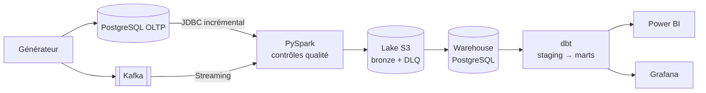
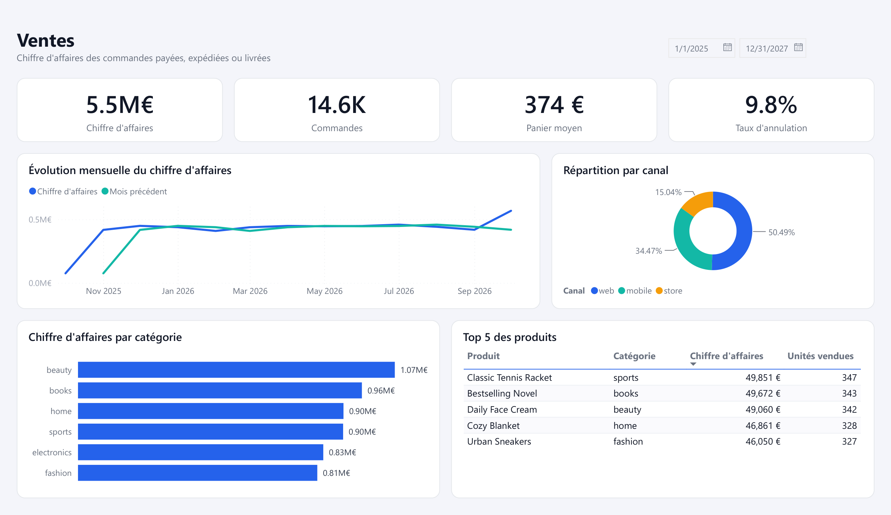
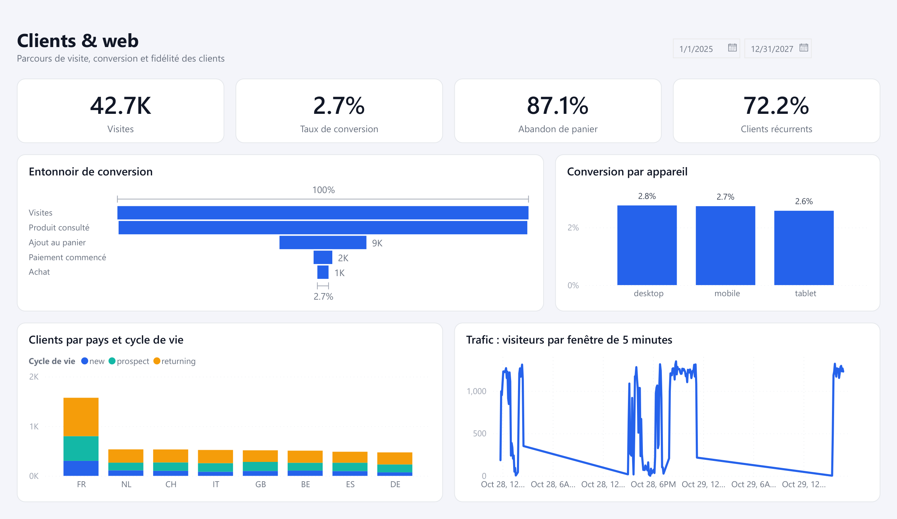
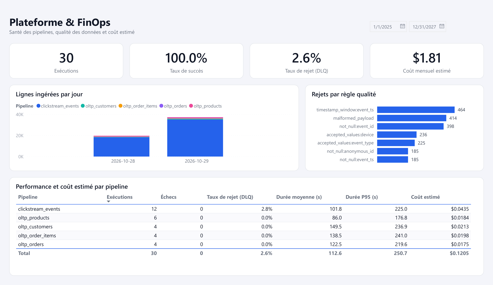
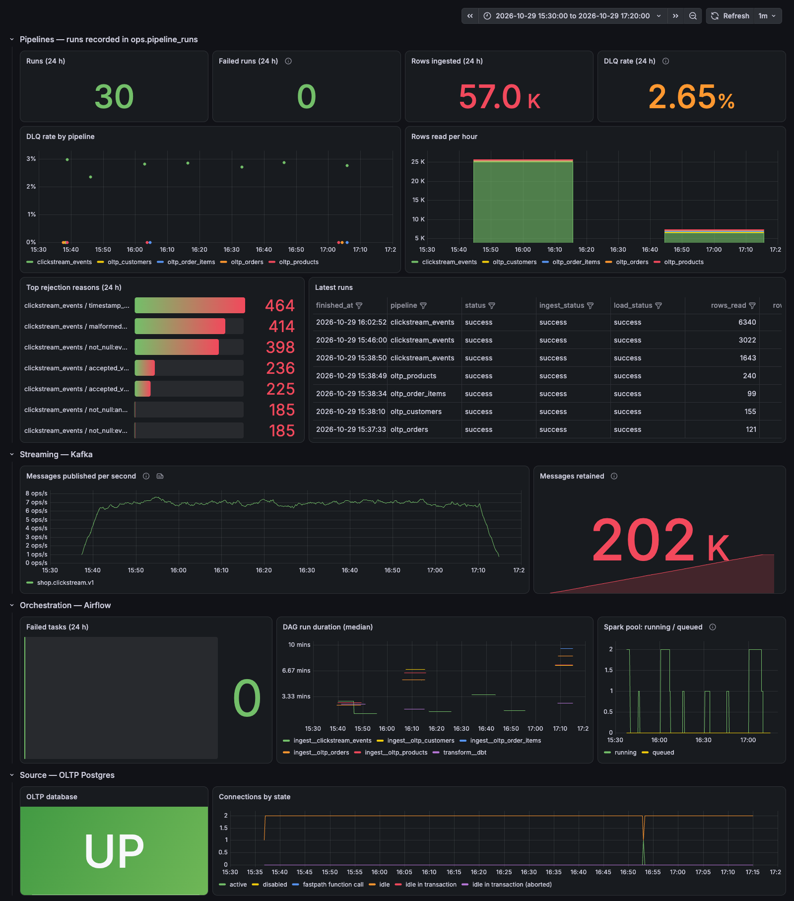

# Stratum — plateforme data de bout en bout

[](https://github.com/Afdal-B/omniflow-data-platform/actions/workflows/ci.yml)     ![dbt](https://img.shields.io/badge/dbt-1.12-FF694B.svg?logo=data%3Aimage%2Fsvg%2Bxml%3Bbase64%2CPHN2ZyBmaWxsPSJ3aGl0ZSIgcm9sZT0iaW1nIiB2aWV3Qm94PSIwIDAgMjQgMjQiIHhtbG5zPSJodHRwOi8vd3d3LnczLm9yZy8yMDAwL3N2ZyI%2BPHRpdGxlPmRidDwvdGl0bGU%2BPHBhdGggZD0iTTE3LjkwMDQgOS4zNzYzYTguMTQ4OCA4LjE0ODggMCAwIDAtMy4wNDIxLTMuMTIwNmwxLjc3MDguODM4NWExMC4yODc0IDEwLjI4NzQgMCAwIDEgMy43NCAzLjAwMDdsMy4yMzQtNS45Mjk1YTIuODU0NiAyLjg1NDYgMCAwIDAtLjA2MTEtMi45NjA0QzIyLjc1NjYuMDM3MSAyMS4yMTEyLS4zNDA5IDE5Ljk3NTQuMzMyN2wtNS44NzQ5IDMuMjEwMWE0LjM2MTIgNC4zNjEyIDAgMCAxLTQuMTc2MSAwTDQuMTc2OS40MDhhMi44NTQ1IDIuODU0NSAwIDAgMC0yLjk1OTIuMDYzMmMtMS4xNjczLjc4NTMtMS41NDUyIDIuMzMtLjg3MjMgMy41NjU1TDMuNTUgOS45MTA2YTQuMzYxMiA0LjM2MTIgMCAwIDEgMCA0LjE3NzJsLTMuMTI3MiA1Ljc0M2EyLjg2IDIuODYgMCAwIDAgLjA4NSAyLjk5NzRjLjc5NCAxLjE0MzggMi4zMjI1IDEuNTA1NCAzLjU0NDguODM4NWw2LjA1ODEtMy4zMDQ5YTEwLjI4NzcgMTAuMjg3NyAwIDAgMS0zLjAwNTEtMy43NDU0bC0uODM3NC0xLjc3MDhhOC4xNDggOC4xNDggMCAwIDAgMy4xMjA2IDMuMDQyMWwxMC41ODMyIDUuNzc5YzEuMjIxMy42NjYgMi43NDgxLjMwNTUgMy41NDI2LS44MzYzYTIuODY5OSAyLjg2OTkgMCAwIDAgLjA3OTYtMy4wMDE4TDE3LjkwMDQgOS4zNzYzem0zLjM4MDEtNy43MzUxYy42MDIyIDAgMS4wOTA0LjQ4ODIgMS4wOTA0IDEuMDkwNHMtLjQ4ODIgMS4wOTA0LTEuMDkwNCAxLjA5MDQtMS4wOTA0LS40ODgyLTEuMDkwNC0xLjA5MDQuNDg4Mi0xLjA5MDQgMS4wOTA0LTEuMDkwNHpNMi43NDQyIDMuODIyYy0uNjAyMiAwLTEuMDkwNC0uNDg4Mi0xLjA5MDQtMS4wOTA0cy40ODgyLTEuMDkwNCAxLjA5MDQtMS4wOTA0IDEuMDkwNC40ODgyIDEuMDkwNCAxLjA5MDRTMy4zNDY0IDMuODIyIDIuNzQ0MiAzLjgyMnptMCAxOC41MzYzYy0uNjAyMiAwLTEuMDkwNC0uNDg4Mi0xLjA5MDQtMS4wOTA0IDAtLjYwMjIuNDg4Mi0xLjA5MDQgMS4wOTA0LTEuMDkwNHMxLjA5MDQuNDg4MiAxLjA5MDQgMS4wOTA0YzAgLjYwMjItLjQ4ODIgMS4wOTA0LTEuMDkwNCAxLjA5MDR6bTEwLjM1ODUtMTEuNDQ4OWMtMS4yMDA4LS4wMDM1LTIuMTc3Ljk2NzItMi4xODA1IDIuMTY3OWEyLjE3MzggMi4xNzM4IDAgMCAwIC43MDUyIDEuNjA5MWMtMS40ODcyLS4yMDkxLTIuNTIzNC0xLjU4NDMtMi4zMTQyLTMuMDcxNi4yMDkxLTEuNDg3MiAxLjU4NDMtMi41MjM0IDMuMDcxNi0yLjMxNDJhMi43MTk0IDIuNzE5NCAwIDAgMSAyLjMxNDIgMi4zMTQyIDIuMTYyMyAyLjE2MjMgMCAwIDAtMS41OTYzLS43MDU0em04LjE3NzggMTEuNDQ4OWMtLjYwMjIgMC0xLjA5MDQtLjQ4ODItMS4wOTA0LTEuMDkwNCAwLS42MDIyLjQ4ODItMS4wOTA0IDEuMDkwNC0xLjA5MDRzMS4wOTA0LjQ4ODIgMS4wOTA0IDEuMDkwNGMwIC42MDIyLS40ODgyIDEuMDkwNC0xLjA5MDQgMS4wOTA0eiIvPjwvc3ZnPg%3D%3D)  ![S3](https://img.shields.io/badge/Lake-S3%20%28RustFS%29-569A31.svg?logo=data%3Aimage%2Fsvg%2Bxml%3Bbase64%2CPHN2ZyBmaWxsPSJ3aGl0ZSIgcm9sZT0iaW1nIiB2aWV3Qm94PSIwIDAgMjQgMjQiIHhtbG5zPSJodHRwOi8vd3d3LnczLm9yZy8yMDAwL3N2ZyI%2BPHRpdGxlPlJ1c3RGUzwvdGl0bGU%2BPHBhdGggZD0iTTAgOS45OTd2NC4wMDZoMS4wODZ2LTEuNDk1aC43NzNjLjE0Mi4wMTMuMjY4LjA1LjM2NC4yMDlsLjYyMSAxLjI4NmgxLjIzOGwtLjYxMS0xLjIyNWMtLjE4Ny0uMzkyLS4zNjktLjQ3OC0uNzE4LS41Ny41MTYtLjA4Ljk2NS0uMzg2Ljk2NS0xLjA4NCAwLS4zMDYtLjExNi0uNjYxLS4zNDgtLjg1MS0uMjI4LS4xOS0uNTM2LS4yNzYtLjkxNS0uMjc2SDEuODZ6bTUuMzM1IDAtMS4wMjIuMjMxdjIuNDczYzAgLjUwMi4xNTguODMuNDU4IDEuMDE2cy43NTguMjg2IDEuMzk4LjI4NmMuNjE2IDAgMS4wNzMtLjEgMS4zODQtLjI4NnEuNDczLS4yOC40NzMtLjk2di0yLjc2bC0xLjAxNy4yMzF2Mi4yNWMwIC4zMS0uMDQ1LjQ5NS0uMTc3LjYzMS0uMTMyLjE0My0uMzczLjE5My0uNjYzLjE5My0uMyAwLS41Mi0uMDU2LS42NjItLjE5My0uMTMyLS4xMy0uMTcyLS40MDUtLjE3Mi0uNzA4Wm00Ljc0IDBxLS44NjQuMDAyLTEuMzM3LjI5N2MtLjMxNS4xOTUtLjQ4MS41OTItLjQ4MS45NzIgMCAuMzI2LjExOS41NzUuMzY4Ljc2NHEuMzY1LjI2NSAxLjMyLjQzM2MuMTk1LjAzNi4zNTYuMDYuNDguMDk1cS4xOS4wNTMuMjguMWMuMTEzLjA2LjE3Mi4xNDkuMTcyLjI0NHEwIC4xODYtLjIxNC4yODRjLS40MjIuMjAyLTEuNjEuMDc3LTIuMDg1LS4xMzZsLS4yMDIuNzY0Yy4wNTMuMDA2LjE0Mi4wMjQuMjUuMDQyLjg3My4xMzYgMi4wMTQuMzE0IDIuNzkyLS4xNzguMzMzLS4yMDcuNTA1LS41MDQuNTA1LS45MTlhLjkzLjkzIDAgMCAwLS4zMzktLjcyOXEtLjMyMS0uMjg0LTEuMjA2LS40MzhjLS4xNzgtLjAzNi0uMzM5LS4wNi0uNDctLjA5NS0uODczLS4xOTYtLjc0OC0uNjg4LjExNC0uNjg4LjQ2MyAwIC45MDkuMTQzIDEuMzQ4LjIybC4wOTUuMDE3LjA5Ni0uODUzYy0uNDY0LS4xNDItMS4wMS0uMTk2LTEuNDg2LS4xOTZtMi4wNzkgMHYuOWgxLjQydjMuMTA2aDEuMzJ2LTMuMTA1aDEuNDEzdi0uOVptNC4zOSAwdjQuMDA2aDEuMzIxdi0xLjQ5NWgyLjExNGwtLjEzLS43NzFoLTEuOTg0di0uODRoMS41NzVsLjEyNC0uOXptNS41NDYgMGMtLjU5NiAwLTEuMDU2LjEtMS4zNy4zMDItLjMzOC4yLS41MS41OS0uNTEuOTc1IDAgLjMyNS4xMy41NzMuMzgxLjc1LjI1OC4xOS43MTMuMzMyIDEuMzY0LjQ0NC4xMzUuMDE4LjI0NS4wMzYuMzQ0LjA2bC4wMTItLjIwOC45MDkuNjEtLjk1Mi41MzEuMDA2LS4xODNjLS41NTkuMDQxLTEuMzYzLS4wNi0xLjczMi0uMjNsLS4yMDMuNzYyYy4wNS4wMTIuMTQyLjAxNy4yNTIuMDQ3LjkwMy4xMzYgMi4wODIuMzEzIDIuODg3LS4xODMuMzUtLjIwMS41MjItLjUwOS41MjItLjkxYS45Mi45MiAwIDAgMC0uMzQ0LS43MzNxLS4zMzItLjI3OS0xLjI0Ny0uNDMyYy0uMTktLjAzNS0uMzUtLjA3LS40OTEtLjA5NHEtLjAxLjAwMi0uMDEyLS4wMDZ2LjIzbC0uOTQtLjU3My45NC0uNTY3di4yMjRoLjEyOWMuNDc5IDAgLjk0LjE0OCAxLjQuMjI1LjA2MS4wMDYuMDg2LjAwNi4wOTIuMDA2bC4wOTgtLjg1MmE2IDYgMCAwIDAtMS41MzUtLjE5NW0tMjEuMDM0Ljc0OGguOTA5cS4zMzkgMCAuNTI2LjEzNGMuMTE2LjA4Ni4xNzEuMjIuMTcxLjQxNyAwIC4yMDgtLjA3LjM2MS0uMjIyLjQ0Ny0uMTMxLjA4LS4zMjguMTIyLS41OC4xMzVoLS44MDRaIi8%2BPC9zdmc%2B)      

Plateforme data de bout en bout pour **OmniFlow**, une boutique en ligne fictive : ingestion de la
base transactionnelle et du clickstream, data lake, modèle analytique dbt, restitution dans Power BI
et supervision dans Grafana. Tout tourne en local avec Docker Compose.

## Architecture



Airflow orchestre l'ensemble avec des DAGs générés depuis un fichier YAML par pipeline.

- **Qualité** : les lignes invalides partent en dead letter queue avec la règle violée.
- **Idempotence** : rejouer un run réécrit le même lot, sans doublons.
- **dbt** : architecture Medallion, 79 tests.
- **FinOps** : coût estimé de chaque pipeline à partir de la durée des runs.

## Résultats









## Démarrage rapide

```bash
cp .env.example .env        # remplacer chaque "change-me"
docker compose --profile jobs build
docker compose up -d
```

La clé `AIRFLOW_FERNET_KEY` se génère avec
`uv run --group airflow python -c "from cryptography.fernet import Fernet; print(Fernet.generate_key().decode())"`.

Airflow : http://localhost:8080 · Grafana : http://localhost:3000 · Entrepôt : `localhost:5434`
